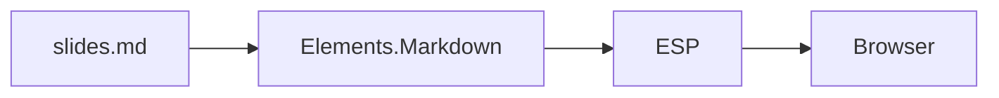

# RemObjects Infrastructure

Shared building blocks for Elements applications and services

---

# Shared code and integrations

| Component | Role |
| --- | --- |
| Infrastructure | Shared application and service code |
| Infrastructure.AI | Model providers and AI integrations |
| Infrastructure.AWS | AWS service integrations |
| Infrastructure.DataAbstract | Data Abstract integrations |

---

# From Markdown to slides

```oxygene
var lOptions := MarkdownOptions.GitHub;
var lHtml := Markdown.ToHtml(lSource, lOptions);
```



---
layout: section
---

# Edit, save, present

Keep the deck in the folder where you work. When you save the Markdown, ESP Slides refreshes the view and keeps your current slide.
